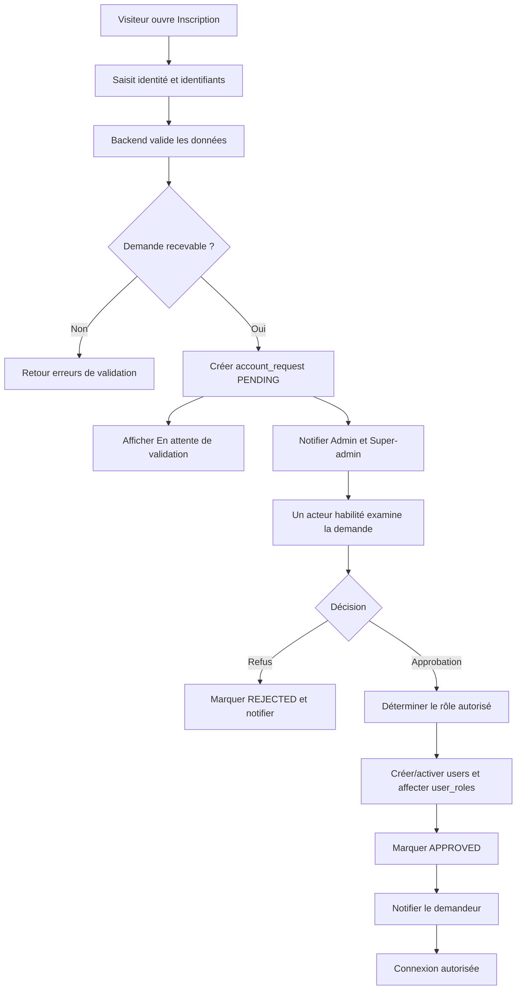

# ROTL MANAGER — Flux d'authentification et validation des comptes

**Version :** 0.1 — proposition à valider

## 1. Objectif

Un visiteur peut soumettre une demande de compte, mais ne peut ni choisir ni s'attribuer un rôle. L'accès aux fonctions métier n'est ouvert qu'après validation par un acteur habilité.

## 2. Flux d'inscription

## 3. Règles de validation

- Le frontend ne transmet aucun rôle demandé comme valeur faisant autorité.
- Le backend détermine les rôles attribuables selon l'identité et les permissions du validateur.
- Seul SUPER_ADMIN peut attribuer ADMIN ou SUPER_ADMIN.
- ADMIN peut approuver les comptes métier qu'il est autorisé à gérer (par exemple MANAGER ou SELLER).
- Un validateur ne peut pas accorder un privilège supérieur ou égal au sien, ni modifier son propre rôle par cette procédure.
- Chaque décision enregistre l'acteur, la date, le statut précédent/nouveau et, si nécessaire, un motif.
- Les demandes en attente ne donnent accès à aucune API métier.
- Une adresse e-mail ou un identifiant déjà utilisé doit être traité avec une réponse qui évite l'énumération de comptes.

## 4. Connexion

1. Le client envoie les identifiants via HTTPS.
2. Spring Security vérifie le compte et le hash de mot de passe.
3. Un compte non ACTIVE est refusé.
4. Après authentification, le serveur émet un access token de courte durée et un mécanisme de renouvellement sécurisé.
5. Les permissions et le périmètre d'établissement sont vérifiés côté serveur sur chaque opération protégée.
6. Déconnexion/révocation invalide le mécanisme de renouvellement ; la stratégie exacte (rotation, stockage hashé, révocation) sera précisée dans la conception sécurité.

Ne jamais placer de secret JWT dans le frontend, le dépôt Git ou les logs. Ne jamais stocker un mot de passe en clair.

## 5. États

| Objet | État | Signification |
|---|---|---|
| Demande | PENDING | En attente d'examen |
| Demande | APPROVED | Acceptée et traitée |
| Demande | REJECTED | Refusée |
| Compte | PENDING | Pas encore activé |
| Compte | ACTIVE | Connexion autorisée |
| Compte | SUSPENDED | Accès bloqué |
| Compte | REJECTED | Compte refusé |

## 6. Notifications

Les demandes nouvelles doivent être visibles aux Admins et Super-admins habilités. Les notifications ne doivent contenir aucun mot de passe ni token. Pour la V1, une notification interne dans l'application peut être suffisante ; e-mail/SMS reste à décider.

## 7. Endpoints REST indicatifs

Les routes ci-dessous sont des propositions à harmoniser avec API_CONTRACT_ROTL_MANAGER.md :

- POST /api/v1/auth/register-requests — soumettre une demande.
- POST /api/v1/auth/login — ouvrir une session.
- POST /api/v1/auth/refresh — renouveler les jetons.
- POST /api/v1/auth/logout — révoquer la session/refresh token.
- GET /api/v1/account-requests — lister les demandes accessibles au validateur.
- POST /api/v1/account-requests/{id}/approve — approuver et attribuer un rôle autorisé.
- POST /api/v1/account-requests/{id}/reject — refuser avec motif.
- GET /api/v1/auth/me — identité, rôles et périmètres du compte courant.

## 8. Cas de test indispensables

- Un demandeur ne peut pas s'attribuer ADMIN dans le payload.
- Un Admin ne peut pas attribuer ADMIN ou SUPER_ADMIN.
- Un utilisateur PENDING, SUSPENDED ou REJECTED ne peut pas se connecter.
- Une demande déjà traitée ne peut pas être approuvée une seconde fois.
- Deux validateurs concurrents ne peuvent pas traiter la même demande de manière incohérente.
- Toute approbation/refus est auditée.
- Un utilisateur d'un établissement ne peut pas lire les données d'un autre établissement sans permission explicite.
