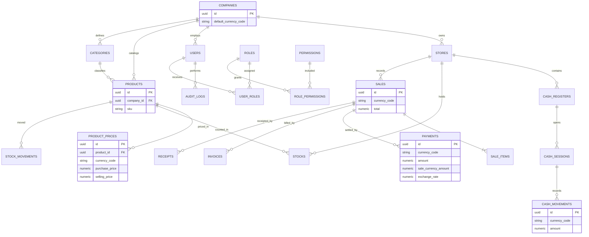

# ROTL MANAGER — Diagramme logique de la base de données

**Version :** 0.2 — modèle multi-devise

## Règles monétaires
- Les prix CDF et USD sont indépendants dans PRODUCT_PRICES.
- Une vente est libellée dans une seule devise.
- Un paiement peut utiliser une autre devise ; le taux et le montant converti sont conservés.
- Les soldes de caisse restent séparés par devise.