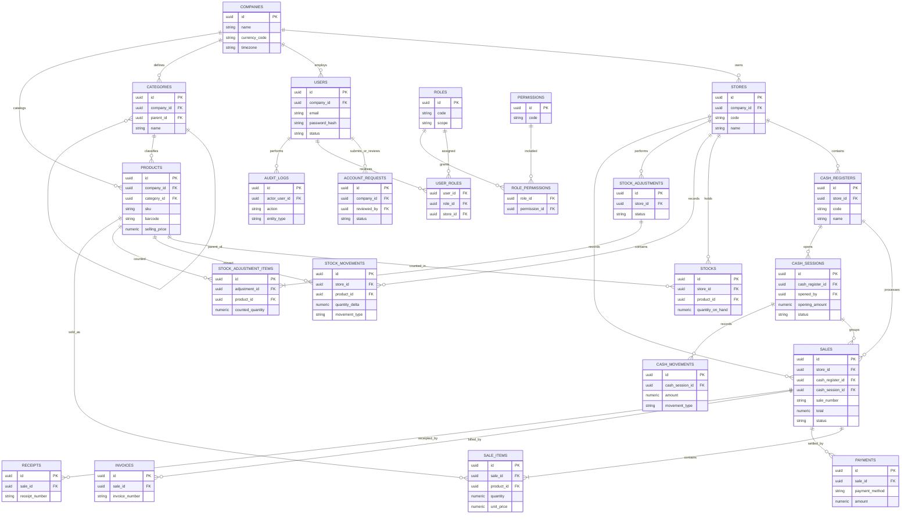

# ROTL MANAGER — Diagramme logique de la base de données

**Version :** 0.1 — alignée sur DATABASE_DESIGN.md

Le diagramme présente les principales relations. Il s'agit d'un modèle logique ; les types SQL, clés composites et contraintes détaillées seront définis dans les migrations Flyway.

## Points d'attention

- La quantité courante de stocks est une projection opérationnelle ; stock_movements reste le journal de traçabilité.
- Les lignes de vente conservent des snapshots du nom, SKU et prix pour préserver l'historique.
- Les ventes et sessions de caisse référencent explicitement établissement et caisse afin de filtrer les rapports.
- Les associations user_roles et role_permissions ont des clés primaires composites.
- Le diagramme ne représente pas toutes les colonnes ni toutes les contraintes. DATABASE_DESIGN.md reste la référence descriptive.
